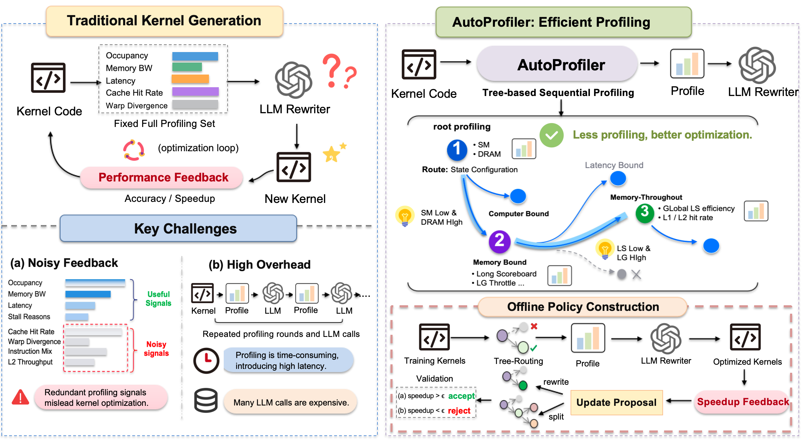

# AutoProfiler

<div align="center">



**LLM-driven GPU kernel optimization where what to profile is learned**

[](LICENSE)
[](https://www.python.org/downloads/)
[](https://developer.nvidia.com/cuda-toolkit)

[Paper](#citation) | [Quick Start](#quick-start) | [Documentation](#layout)

</div>

---

## Overview

**The Problem:** Traditional GPU kernel optimizers measure a fixed set of performance counters and show them all to an LLM, regardless of whether those metrics are relevant to the specific kernel. This wastes both profiling time and LLM reasoning capacity.

**Our Solution:** AutoProfiler trains a *profiling tree* that decides what to measure for each kernel. Starting at the root, it measures only the counters that node requests, uses the readings to descend to a specific leaf, and provides the counters collected along the path to an LLM that rewrites the kernel. The routing is deterministic—no LLM involved—and driven purely by measured hardware counters. The tree structure itself is **learned from downstream speedups**.

### Key Features

- 🎯 **Learned Profiling Strategy**: Trains decision trees that select which metrics matter for each kernel class
- 🚀 **Efficient Measurement**: Only profiles what's needed—no wasted counter reads
- 🔧 **Unified Evaluation Framework**: All methods run on the same LLM, GPU backend, and budget for fair comparison
- 📊 **Comprehensive Baselines**: Includes re-implementations of CudaForge, KernelMem, KernelAgent, and AutoKernel
- 🔬 **Reproducible**: Every experiment is config-driven with checkpoint/resume support

### Verified Results

On KernelBench test set (250 GPU kernels):
- **Measurement-guided routing**: 1.0 success vs 0.5 static routing on all-matmul corpus (M5)
- **Real-world advantage**: 0.667 vs 0.333 generic baseline, CI [0.417, 0.917] (M6)
- **Mechanism diversity**: Works across tensor-core precision (tf32/fp16), memory bandwidth, and compute patterns

---

## Install

### Basic Installation

```bash
# Install driver (any machine)
pip install -e ".[dev]"

# On GPU machine: add PyTorch + Triton
pip install -e ".[gpu]"
```

### Requirements

- **Python**: 3.8+
- **GPU Workers**: CUDA toolkit + Nsight Compute (`ncu`) with performance counter permissions
- **Hardware**: Reported results measured on RTX 4090

### LLM Configuration

Set your API key in the environment (or create a `.env` file):

```bash
export OPENAI_API_KEY=sk-...
# Or for other providers:
export ANTHROPIC_API_KEY=...
export QWEN_API_KEY=...
```

Choose the LLM profile in `configs/llm/` (`gpt`, `claude`, or any OpenAI-compatible endpoint—see `openai_compatible.example.yaml`).

---

## Quick Start

```bash
# Run tests (no GPU/network needed)
pytest -q

# Smoke test: 3 problems × 2 rounds × all methods (needs GPU + LLM)
scripts/examples/03_eval_smoke.sh
```

---

## Reproducing Results

### Main Table

Each method has one config under `configs/eval/`. Run individually or all together:

```bash
# Single method, full run
scripts/eval.sh configs/eval/autoprofiler.yaml

# Quick validation first
scripts/eval.sh configs/eval/cudaforge.yaml --limit 3 --rounds 2

# All methods in sequence
scripts/examples/04_main_table.sh

# Regenerate report from existing results
scripts/examples/05_report.sh output/results/autoprofiler
```

**Config Philosophy:** Each config file is a complete experiment specification—benchmark, method components, LLM, GPU backend, round budget, timing protocol. For fair comparison, shared parameters (model, rounds, timing) must match across configs.

**Swapping Profilers:** The central claim is about the profiler. Replace `ncu_fixed` with the learned tree in any baseline:

```yaml
profiler:
  type: tree
  path: output/trees/autoprofiler.json
```

**Output:** Results write per-task as they complete (interrupted runs resume automatically). Reports show per-method and per-KernelBench-level:
- Correctness rate
- `fast_1`: fraction correct AND faster than PyTorch
- Geometric mean speedup with 95% bootstrap confidence intervals
- LLM tokens and GPU seconds per task

Failed tasks count as 1.0× in `geomean_all` (falling back to PyTorch), so methods can't game metrics by failing quietly.

---

## Training a Tree

```bash
# Smoke test on 100-program example corpus (in repo)
scripts/examples/01_train_tree_example.sh

# Full training on 999-program corpus (download first)
scripts/examples/02_train_tree_full.sh

# Use default config
scripts/train.sh
```

**How It Works:**
- `scripts/train.sh` auto-discovers GPU (local or k8s pod from `configs/backends/k8s.yaml`)
- All settings come from `configs/train/default.yaml`: corpus, LLMs, output path
- Two LLM stages can use different models:

```yaml
propose:    {llm: gpt}      # Generate REWRITE metric proposals, SPLIT conditions
optimize:   {llm: claude}   # Leaf kernel optimizer
```

Run artifacts (checkpoints, logs, per-round trees) save to `output/train/`. Training requires CUDA GPU with Nsight Compute + LLM credits.

---

## Data

| What | Location | In Git? |
|------|----------|---------|
| KernelBench test set (250 problems) | `data/benchmarks/kernelbench/` | ✅ Yes |
| Training corpus: 100-program example | `data/train/example/` | ✅ Yes |
| Training corpus: full 999 programs | `data/train/full/` | ❌ No: Download from [HuggingFace](https://huggingface.co/TODO) |
| Released tree | `output/trees/autoprofiler.json` | ✅ Yes; also on [HuggingFace](https://huggingface.co/TODO) |

The training corpus contains synthetic PyTorch programs and verified Triton ports, disjoint from KernelBench (test-only). Format details: [`data/README.md`](data/README.md).

---

## Project Layout

```
autoprofiler/
  core/        Task, Candidate, Trajectory; component interfaces; 
               registry; Evaluator; benchmark loader
  seeders/     Initial candidate generation: torch_baseline, llm_port
  profilers/   Profiling strategies: none, ncu_fixed, tree (AutoProfiler)
  optimizers/  Optimization backends: leaf (AutoProfiler), baselines
  baselines/   CudaForge, KernelMem, KernelAgent, AutoKernel implementations
  npt/         Tree structure, training loop, REWRITE/SPLIT, reward computation
  eval/        Unified runner and statistical reporting
  backends/    Execution: local GPU or Kubernetes pod (kubectl exec)
  llm/         Unified LLM client with call/token accounting

configs/       Configuration system
  llm/         Model endpoints and API keys
  backends/    GPU execution backends
  benchmarks/  Test suite definitions
  methods/     Method component specifications
  eval/        Complete experiment configs
  train/       Training hyperparameters

scripts/       Entry points: train.sh, eval.sh, examples/, data/
data/          Benchmarks and training corpora
output/        Results, trees, checkpoints
```

### Extending the Framework

- **Add a method/profiler/benchmark**: See [`docs/extending.md`](docs/extending.md)
- **Baseline fidelity**: What each baseline keeps vs. simplifies—[`docs/baselines.md`](docs/baselines.md)

---

## Citation

```bibtex
@inproceedings{autoprofiler2026,
  title     = {AutoProfiler: Learning What to Profile for GPU Kernel Optimization},
  author    = {TODO},
  booktitle = {TODO},
  year      = {2026}
}
```

---

## License

This project is licensed under the Apache License 2.0 - see the [LICENSE](LICENSE) file for details.

Third-party attributions: [NOTICE](NOTICE)

---

## Acknowledgments

This research was supported by [TODO]. We thank the authors of KernelBench, CudaForge, KernelMem, KernelAgent, and AutoKernel for their foundational work.

---

<div align="center">
Built with ❤️ for the GPU optimization community
</div>

